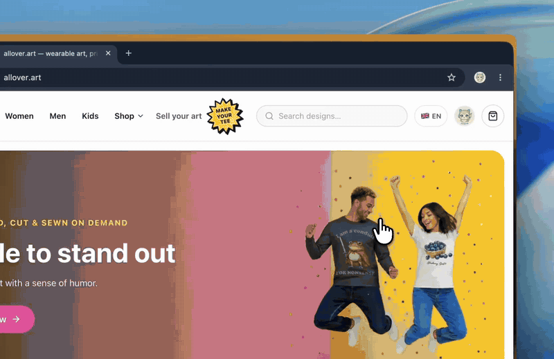

# AgenTee — allover.art MCP server

[](https://smithery.ai/servers/we-6lza/AgenTee)




**The first print-on-demand store your AI agent can run for you.**

Give your agent a personal token and it can search 30,000+ all-over-print **100% cotton** tees, build and edit your cart, apply promo codes, fill in shipping and prepare a ready-to-pay checkout. **Payment always stays with the human** — there are no payment tools, by design.

- Website & tokens: https://allover.art/agentee
- Endpoint: `https://allover.art/mcp` (remote, Streamable HTTP, JSON-RPC 2.0)
- Auth: `Authorization: Bearer <your token>` — free personal tokens, issued in one click

## Quick start

**Claude Code**

```bash
claude mcp add --transport http agentee https://allover.art/mcp --header "Authorization: Bearer YOUR_TOKEN"
```

**Any MCP client (JSON config)**

```json
{"agentee": {"type": "http", "url": "https://allover.art/mcp", "headers": {"Authorization": "Bearer YOUR_TOKEN"}}}
```

Then ask your agent something like: *"find me a loud cotton tee with a cat under $40 and get it ready to buy"*.

## What the agent can do

- Search the catalog by vibe, theme or budget; browse collections
- Build and edit the cart, apply promo codes
- Fill shipping address, pick delivery method
- Prepare a fully pre-filled checkout — the human reviews and pays in the browser
- Track orders after purchase
- *Coming next:* create brand-new designs in Studio from a one-line prompt

## Safety model

- No payment tools; checkout is completed by the human in the browser
- Tokens are scoped to the owner's cart/orders only, rate-limited, revocable in one click
- Every agent action is logged

## About allover.art

We print bold all-over designs on real 100% cotton at our own factory (reactive printing — the dye bonds inside the fiber, so prints survive 60°C washes without cracking or fading). Made to order, shipped worldwide. Designers earn a flat 10% of every sale, for life: https://allover.art/become-a-designer
